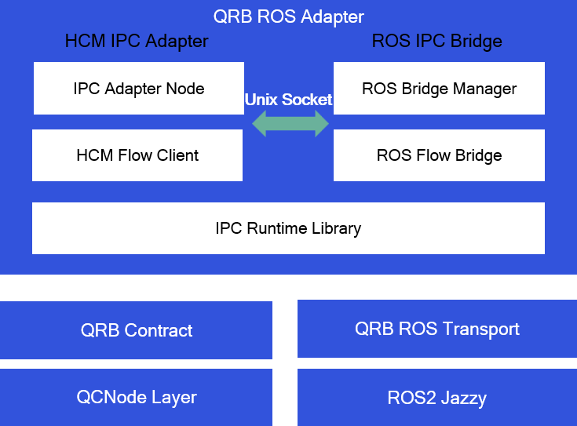

  <h1>QRB ROS Adapter</h1>
  
ROS and HCM IPC bridge for Qualcomm Robotics Platforms

  
  

---

## Overview

[QRB ROS Adapter](https://github.com/qualcomm-qrb-ros/qrb_ros_adapter) bridges Contract messages between HCM and ROS 2 over Unix domain sockets. It provides the IPC runtime shared by both sides of the bridge, an HCM IPC Adapter, and a ROS IPC Bridge that creates typed ROS flow bridges for registered HCM flows.

  

 

The repository contains three components:

- `ipc_runtime`: ROS- and HCM-independent IPC definitions and transport.
- `hcm_ipc_adapter`: IPC Adapter Node and HCM Flow Client.
- `ros_ipc_bridge`: ROS 2 Bridge Manager and typed ROS Flow Bridge.

Installation, build, runtime, and test workflows are not ready yet.

## Table of contents

- [APIs](#apis)
- [Supported targets](#supported-targets)
- [Installation](#installation)
- [Usage](#usage)
- [Build from source](#build-from-source)
- [Test](#test)
- [Contributing](#contributing)
- [License](#license)

## APIs

The ROS IPC Bridge manages typed ROS 2 endpoints for HCM flow registrations. It supports inline Contract messages and DMA-BUF payloads transferred through Unix domain sockets using file descriptors.

| Component | Responsibility |
| --- | --- |
| `ipc_runtime` | Defines IPC control messages, flow registration, transport headers, and socket sessions. |
| `hcm_ipc_adapter` | Connects HCM flows to the IPC runtime and converts supported Contract payloads. |
| `ros_ipc_bridge` | Creates ROS-facing flow bridges and converts between ROS messages and Contract payloads. |

## Supported targets

| Development hardware | Operating system | ROS distribution |
| --- | --- | --- |
| Qualcomm Dragonwing IQ-9075 EVK | Qualcomm Ubuntu 24.04 | ROS 2 Jazzy |

## Installation

Installation packages and setup instructions are not ready yet.

## Usage

Runtime launch and flow-registration instructions are not ready yet.

## Build from source

Source build instructions are not ready yet.

## Contributing

Contribution guidance is not ready yet for this intermediate release.

## License

This project is licensed under the BSD-3-Clause-Clear license.
